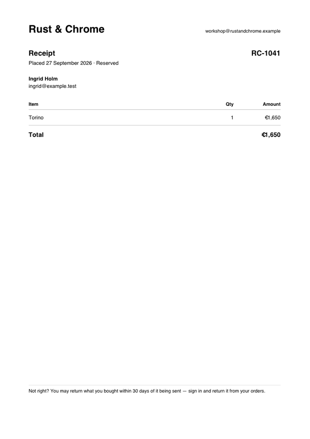

# Osysharp.PdfWriter — write a PDF from Osy#

## Use case

Your app has to hand someone a document: a receipt, an invoice, a packing slip, a certificate, a statement. This
package writes one line by line: text in Helvetica and Helvetica-Bold, right-aligned columns, rules and pages.
The result is a few kilobytes and opens in any PDF reader.



*A shop's receipt, written by the `Osysharp.Shop` package with this kit.*

## Install and use

```osy
app Invoicing {
  use Osysharp.PdfWriter@0;
  use Osysharp.Storage;          // only if you save the file, as below
  model "model/**/*.osy";
}
```

```osy
using Osysharp.PdfWriter;

public string InvoicePdf(Invoice invoice) {
  var pdf = new PdfDocument { Title = $"Invoice {invoice.Number}" };
  var top = pdf.PageHeight - 60;
  pdf.Text(56, top, "Acme Ltd", 20, bold: true);
  pdf.TextRight(pdf.PageWidth - 56, top, $"Invoice {invoice.Number}", 14, bold: true);
  pdf.Line(56, top - 20, pdf.PageWidth - 56, top - 20, 0.5, 0.7);

  var y = top - 44;
  foreach (var line in invoice.Lines) {
    pdf.Text(56, y, line.Description);
    pdf.TextRight(pdf.PageWidth - 56, y, $"€{line.Amount:0.00}");
    y = y - 18;
    if (y < 60) { pdf.NewPage(); y = pdf.PageHeight - 60; }
  }

  var path = $"invoices/{invoice.Id}.pdf";
  File.WriteAllBytes(path, pdf.ToBytes());
  return File.SignedUrl(path);   // a private file, handed over as a link that expires
}
```

Positions are in points (1/72 inch), measured from the **bottom-left** corner, which is how PDF counts them. So a
page is written top-down by subtracting from `PageHeight`.

## What it ships

| member | what it does |
|---|---|
| `PageWidth`, `PageHeight` | A4 by default; set both before the first page for US Letter (612 × 792) |
| `Title` | the title a reader shows in its window |
| `Text(x, y, text, size, bold)` | text with its left end at `x` and its baseline at `y` |
| `TextRight(x, y, text, size, bold)` | text with its RIGHT end at `x`, for a column of amounts |
| `Line(x1, y1, x2, y2, width, shade)` | a rule; `shade` runs from 0 (black) to 1 (white) |
| `Width(text, size, bold)` | how wide a piece of text is, from Helvetica's own character widths |
| `Wrap(text, width, size, bold)` | a paragraph broken into lines that fit `width` |
| `NewPage()` | starts the next page; the first `Text` or `Line` starts page one for you |
| `ToBytes()` | the finished file |

**No font is embedded, and none needs to be.** Helvetica is one of the fourteen faces every PDF reader carries.
The price is the character set, WinAnsi. It covers every Western European language (å ä ö é ü ß ø …), the euro
sign and typographic dashes and quotes. A character outside it is written as `?` rather than silently dropped.

## Build your own on top

Tables, headers and footers, a letterhead: write them as functions of your own over `PdfDocument`. A
`Letterhead(pdf, company)` that draws your logo line and address block is five calls. If you need something the
class cannot do, such as images or another font, fork the repository. The whole writer is one file of ordinary
Osy# over strings, so the PDF objects it writes are all there to read and extend.

## Source and tests

`model/PdfDocument.osy`, with no C# anywhere. `tests/` is the producer's own project: tests that parse the file they write back (page count, the text, the
euro sign's WinAnsi byte, right alignment). It does not ship with the package.

